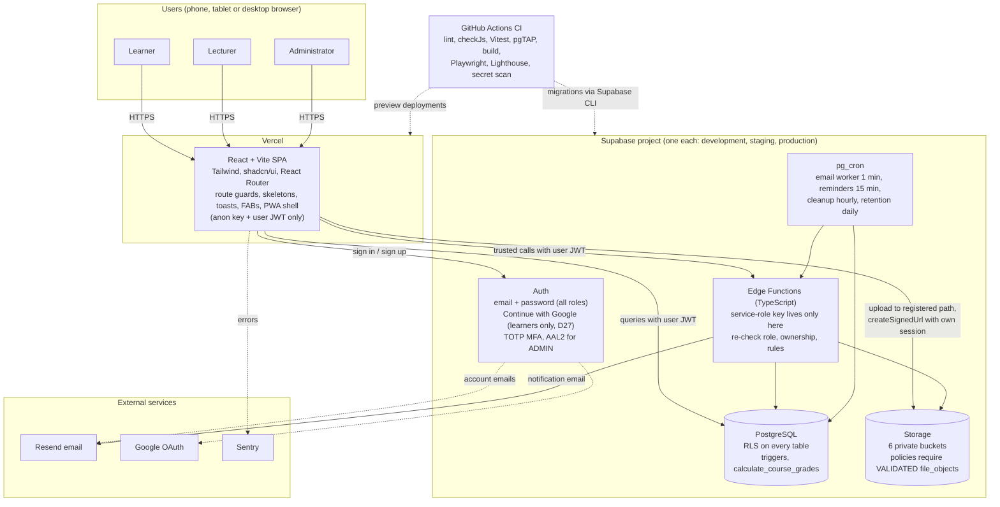
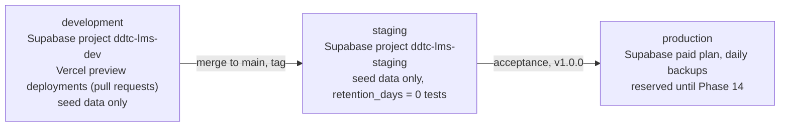

# 1. System and context architecture

Source: BUILD_PLAN v1.7 Sections 2, 6, 8 and D18, D19, D22, D26, D27. The service-role key exists only inside Edge Functions (and server settings); the browser always uses the signed-in user's own session.

## Environments

Real learner data is never used in development or staging.
