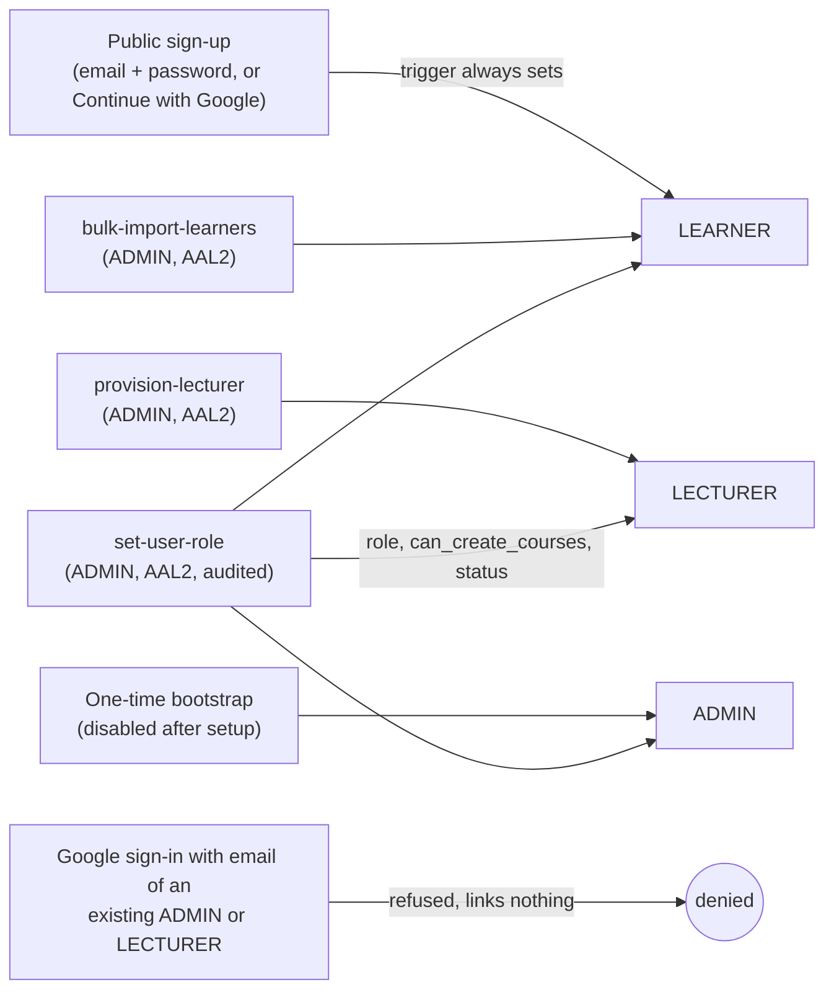
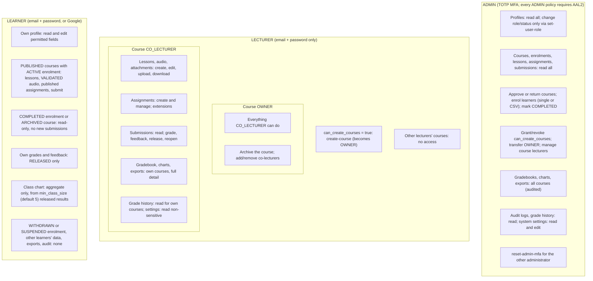

# 2. Role and permission map

Source: BUILD_PLAN v1.7 Section 7 and D01, D02, D03, D05, D06, D22, D27, D28, D32, D35. Route guards only decide what the screen shows; RLS, Storage policies and Edge Functions enforce every rule below.

## How a role is obtained

Account status (D03): only ACTIVE users can use the system. SUSPENDED and DEACTIVATED users are signed out, all sessions revoked, and refused at sign-in.

## What each role can do

## Enforcement layer per rule

| Rule | Enforced by |
|---|---|
| Role and status cannot be changed by the user | RLS + column privileges on `profiles`; `set-user-role` Edge Function |
| Sign-up always yields LEARNER | Database trigger on `auth.users` |
| Google refused for ADMIN and LECTURER emails | Auth hook / trigger (mechanism stated in Phase 3) |
| ADMIN privileged operations need AAL2 | RLS checks `auth.jwt() ->> 'aal'`; Edge Functions re-check |
| Lecturer isolation between courses | RLS joined on `course_lecturers` |
| Learner sees only enrolled, published content | RLS joined on `course_enrollments` and publication status |
| Only VALIDATED files readable | Storage policies joined on `file_objects.status` |
| Unreleased grades private | RLS on `submissions.grade_release_status` |
