# 3. Database ERD

Source: BUILD_PLAN v1.7 Section 5. Every table has RLS enabled with no default access, `id uuid` primary key (except `system_settings`), `created_at`, and `updated_at` maintained by trigger. Every foreign key to an academic record uses `ON DELETE RESTRICT` (D25). Tables are created in the phases noted in brackets.

```mermaid
erDiagram
  AUTH_USERS ||--|| PROFILES : "id"
  PROFILES ||--o| NOTIFICATION_PREFERENCES : "user_id"
  PROFILES ||--o{ AUDIT_LOGS : "actor_id"
  PROFILES |o--o| FILE_OBJECTS : "profile_image_file_id"

  PROFILES ||--o{ COURSE_LECTURERS : "lecturer_id"
  PROFILES ||--o{ COURSE_ENROLLMENTS : "learner_id"
  COURSES ||--o{ COURSE_LECTURERS : "course_id"
  COURSES ||--o{ COURSE_ENROLLMENTS : "course_id"
  COURSES |o--o| FILE_OBJECTS : "cover_image_file_id"
  COURSES ||--o{ LESSONS : "course_id"
  COURSES ||--o{ GRADE_CATEGORIES : "course_id"
  COURSES ||--o{ ASSIGNMENTS : "course_id"

  LESSONS ||--o{ LESSON_AUDIO_FILES : "lesson_id"
  LESSONS ||--o{ LESSON_ATTACHMENTS : "lesson_id"
  LESSONS ||--o{ LESSON_PROGRESS : "lesson_id"
  PROFILES ||--o{ LESSON_PROGRESS : "learner_id"
  FILE_OBJECTS ||--o| LESSON_AUDIO_FILES : "file_object_id"
  FILE_OBJECTS ||--o| LESSON_ATTACHMENTS : "file_object_id"

  LESSONS |o--o{ ASSIGNMENTS : "lesson_id (nullable)"
  GRADE_CATEGORIES ||--o{ ASSIGNMENTS : "category_id"
  FILE_OBJECTS |o--o| ASSIGNMENTS : "instruction_audio_file_id"
  ASSIGNMENTS ||--o{ ASSIGNMENT_VERSIONS : "assignment_id"
  ASSIGNMENTS ||--o{ SUBMISSION_EXTENSIONS : "assignment_id"
  PROFILES ||--o{ SUBMISSION_EXTENSIONS : "learner_id"
  ASSIGNMENTS ||--o{ SUBMISSIONS : "assignment_id"
  PROFILES ||--o{ SUBMISSIONS : "learner_id"
  SUBMISSIONS ||--o{ SUBMISSION_VERSIONS : "submission_id"
  SUBMISSION_VERSIONS ||--o{ SUBMISSION_FILES : "submission_version_id (max 5)"
  FILE_OBJECTS ||--o| SUBMISSION_FILES : "file_object_id"
  SUBMISSIONS ||--o{ GRADE_CHANGE_HISTORY : "submission_id"

  PROFILES ||--o{ NOTIFICATIONS : "recipient_id"
  NOTIFICATIONS ||--o{ NOTIFICATION_DELIVERIES : "notification_id"
  PROFILES ||--o{ RETENTION_HOLDS : "placed_by"

  PROFILES {
    uuid id PK "= auth.users.id [Phase 2]"
    text first_name
    text second_name
    text email
    text contact_number
    enum role "ADMIN | LECTURER | LEARNER, not user-editable"
    bool can_create_courses "default false, not user-editable"
    enum account_status "ACTIVE | SUSPENDED | DEACTIVATED"
    bool profile_completed
    uuid profile_image_file_id FK
  }
  SYSTEM_SETTINGS {
    text key PK "[Phase 2]"
    jsonb value
    uuid updated_by FK
    timestamptz updated_at
  }
  AUDIT_LOGS {
    uuid id PK "[Phase 2] append-only"
    uuid actor_id FK
    text action
    text entity_type
    uuid entity_id
    jsonb metadata
  }
  NOTIFICATION_PREFERENCES {
    uuid user_id FK "[Phase 2]"
    bool email_enabled
  }
  FILE_OBJECTS {
    uuid id PK "[Phase 2 or before first upload]"
    text bucket_name
    text storage_path UK "server-generated"
    text original_filename
    text safe_download_filename
    text detected_mime_type
    bigint file_size
    int duration_seconds
    uuid uploaded_by FK
    enum status "PENDING | VALIDATED | REJECTED | DELETED | DELETE_FAILED"
    text resource_type
    uuid resource_id
    text checksum
    text validation_error
  }
  COURSES {
    uuid id PK "[Phase 5]"
    text title
    text course_code UK
    text category
    enum status "DRAFT | PENDING_APPROVAL | PUBLISHED | ARCHIVED"
    bool missing_as_zero "default false"
    uuid created_by FK
    timestamptz archived_at
  }
  COURSE_LECTURERS {
    uuid course_id FK "[Phase 5] UK(course_id, lecturer_id)"
    uuid lecturer_id FK
    enum permission_level "OWNER | CO_LECTURER"
    uuid assigned_by FK
  }
  COURSE_ENROLLMENTS {
    uuid course_id FK "[Phase 5] partial UK active per learner"
    uuid learner_id FK
    enum enrolment_status "ACTIVE | COMPLETED | WITHDRAWN | SUSPENDED"
    uuid enrolled_by FK
  }
  LESSONS {
    uuid course_id FK "[Phase 6] UK(course_id, position)"
    text title
    text content "sanitised HTML"
    int position
    enum publication_status
  }
  LESSON_AUDIO_FILES {
    uuid lesson_id FK "[Phase 6] one ACTIVE per lesson"
    uuid file_object_id FK
    enum lifecycle_status "ACTIVE | SUPERSEDED | ARCHIVED"
  }
  LESSON_ATTACHMENTS {
    uuid lesson_id FK "[Phase 6]"
    uuid file_object_id FK
    text title
    int position
  }
  LESSON_PROGRESS {
    uuid learner_id FK "[Phase 6] UK(learner_id, lesson_id)"
    uuid lesson_id FK
    enum completion_status
  }
  GRADE_CATEGORIES {
    uuid course_id FK "[Phase 7] weights total 100"
    text name
    numeric weight "0-100"
  }
  ASSIGNMENTS {
    uuid course_id FK "[Phase 7]"
    uuid lesson_id FK "nullable"
    uuid category_id FK
    enum content_type "TEXT | AUDIO | TEXT_AND_AUDIO (CHECK)"
    timestamptz due_at
    bool allow_late
    numeric max_marks "> 0"
    text_array accepted_formats
    enum publication_status
  }
  ASSIGNMENT_VERSIONS {
    uuid assignment_id FK "[Phase 7] snapshots"
    int version_number
    uuid changed_by FK
    text change_reason
  }
  SUBMISSION_EXTENSIONS {
    uuid assignment_id FK "[Phase 8] UK(assignment_id, learner_id)"
    uuid learner_id FK
    timestamptz extended_due_at
    uuid granted_by FK
  }
  SUBMISSIONS {
    uuid assignment_id FK "[Phase 8] UK(assignment_id, learner_id)"
    uuid learner_id FK
    enum status "DRAFT | SUBMITTED | GRADED | REOPENED"
    int current_version
    bool is_late
    numeric score "0..max_marks (trigger)"
    text feedback
    enum grade_release_status "DRAFT | RELEASED"
  }
  SUBMISSION_VERSIONS {
    uuid submission_id FK "[Phase 8] UK(submission_id, version_number)"
    int version_number
    text text_answer
    timestamptz submitted_at
    bool is_late
  }
  SUBMISSION_FILES {
    uuid submission_version_id FK "[Phase 8]"
    uuid file_object_id FK
    enum file_role "AUDIO | PDF | DOCX | OTHER"
  }
  GRADE_CHANGE_HISTORY {
    uuid submission_id FK "[Phase 9] trigger-written, immutable"
    numeric previous_score
    numeric new_score
    uuid changed_by FK
    text reason
  }
  NOTIFICATIONS {
    uuid recipient_id FK "[Phase 11]"
    text notification_type
    text deduplication_key UK
    timestamptz read_at
  }
  NOTIFICATION_DELIVERIES {
    uuid notification_id FK "[Phase 11]"
    enum status "QUEUED | SENT | RETRYING | FAILED | SUPPRESSED"
    int attempts
    timestamptz next_attempt_at
  }
  RETENTION_HOLDS {
    enum scope "[Phase 12] SUBMISSION | LEARNER | COURSE"
    uuid scope_id
    uuid placed_by FK
    timestamptz released_at
  }
  RETENTION_RUNS {
    enum mode "[Phase 12] DRY_RUN | LIVE"
    int eligible_count
    int deleted_count
    int failed_count
  }
```

`file_objects.resource_type` and `resource_id` describe the owning resource for the upload pipeline; resource tables reference `file_object_id` and never duplicate validation state or store raw paths (D33). `retention_runs` has no foreign keys.
