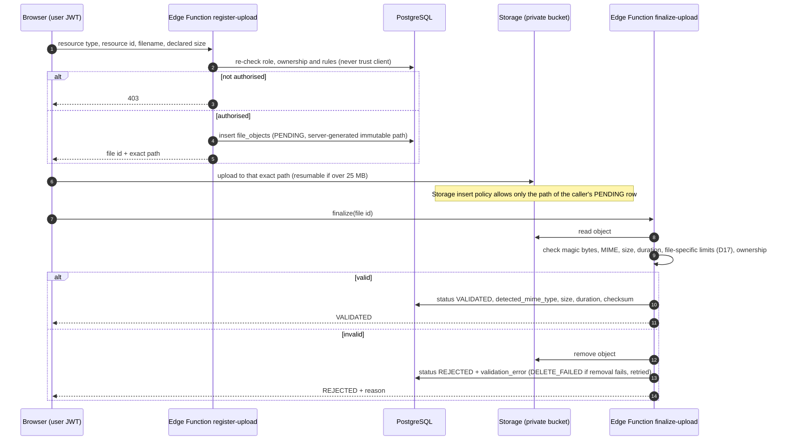
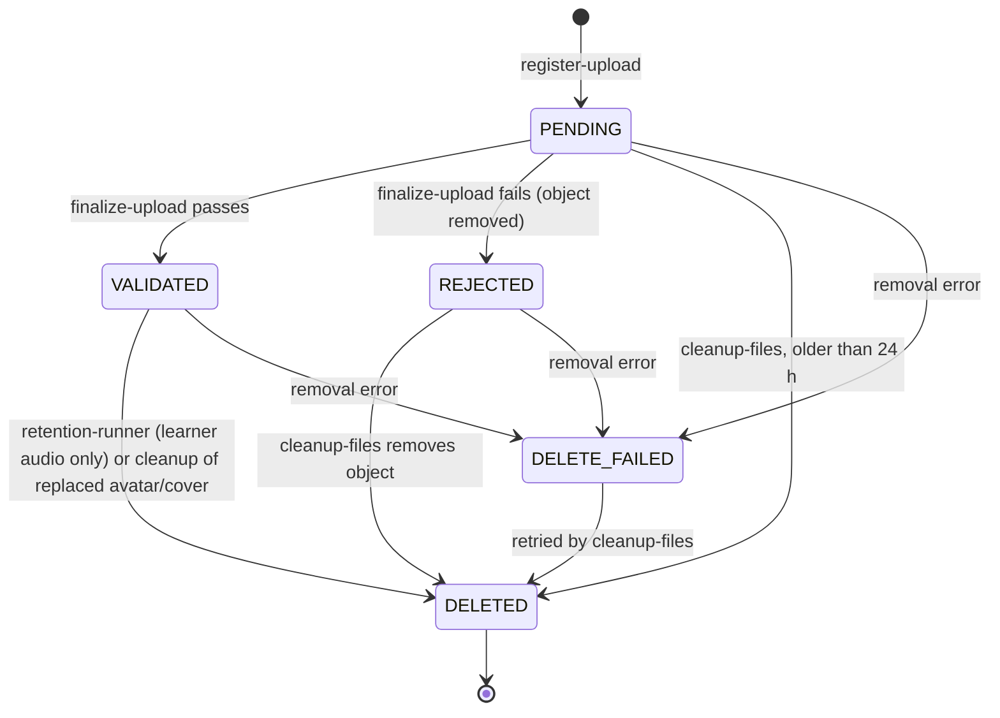
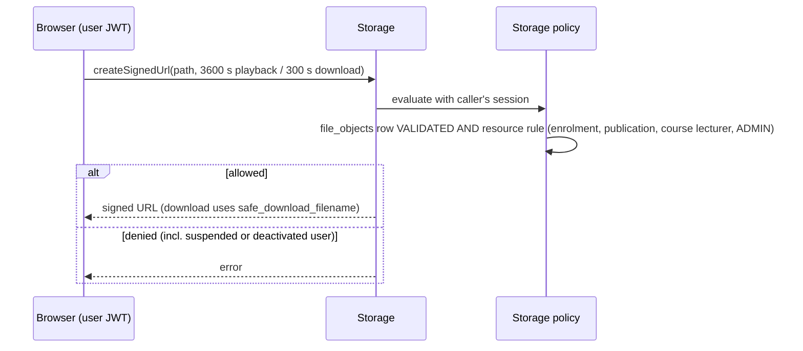

# 4b. Workflow: validated upload pipeline and file access

Source: D18, D19, D33 and BUILD_PLAN Section 6. One pipeline for every bucket; no ad-hoc direct-to-Storage uploads.

## File status

## Playback and download (no Edge Function, no service role)

