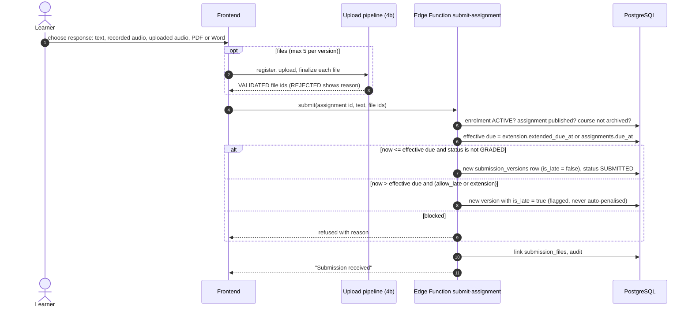
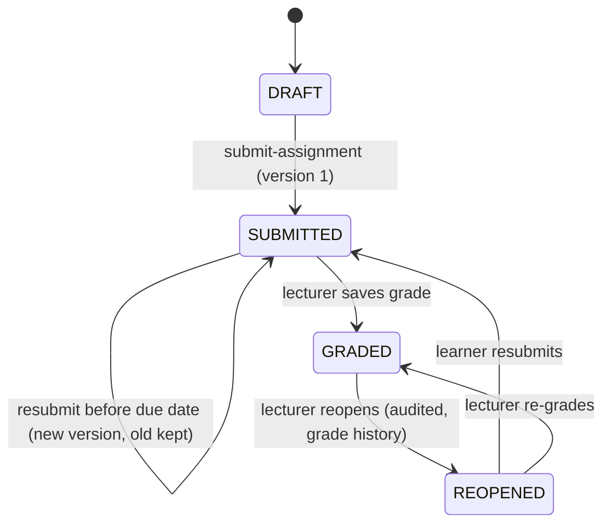

# 4c. Workflow: assignment submission

Source: D10, D11, D13, D24 and BUILD_PLAN Phase 8. Lateness and due dates are decided by server time only.

Missing work never creates a submission row (D11); it is derived at read time by `calculate_course_grades`.
