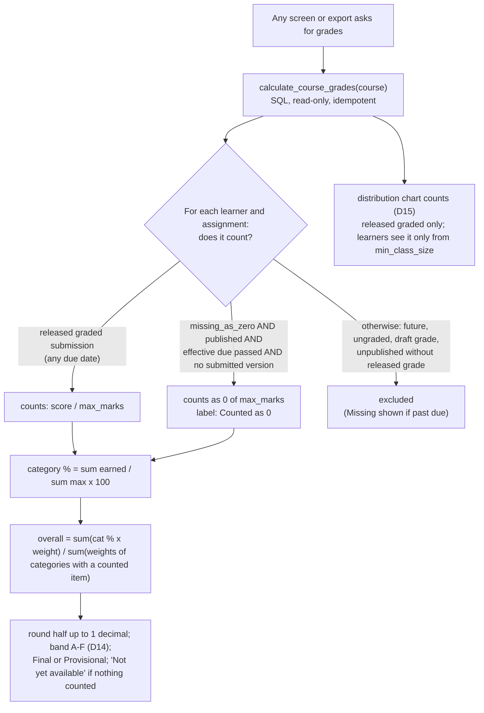

# 4d. Workflow: grading, release and recalculation

Source: D11, D12, D13, D14, D15, D16, D30, D35 and BUILD_PLAN Phases 9 and 10. Nothing is stored as an aggregate; `calculate_course_grades` is the only place grade formulas exist.

```mermaid
sequenceDiagram
  autonumber
  actor Lec as Lecturer (course lecturer)
  participant FE as Frontend
  participant DB as PostgreSQL
  participant RG as Edge Function release-grades
  actor Lrn as Learner

  Lec->>FE: enter score and feedback
  FE->>DB: update submissions (RLS: course lecturer; trigger checks 0 <= score <= max_marks)
  Note over DB: grade_release_status stays DRAFT; learner cannot read it
  Lec->>FE: Release (one submission or whole assignment)
  FE->>RG: release-grades (user JWT)
  RG->>DB: re-check course lecturer rights; category weights total 100 (then locked)
  RG->>DB: grade_release_status = RELEASED, released_at = now()
  RG->>DB: notifications + notification_deliveries + audit_logs
  DB-->>Lrn: in-app and email "grade released"
  opt later change to a released grade
    Lec->>DB: update score or feedback
    DB->>DB: trigger writes grade_change_history (immutable) + audit + learner notification
  end
```

## Calculation on read (D13)


