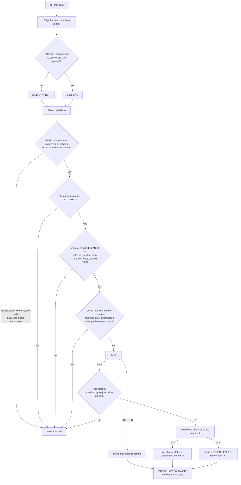

# 4e. Workflow: learner-audio retention

Source: D20, D25, D33, ADR-022 and BUILD_PLAN Phase 12. `retention_enabled` = false at launch; dry run for the first 30 days (enforced by the database); only an administrator can enable live deletion. Examination recordings are included (ADR-022).

Submission, grade, feedback and history rows always remain. Staging tests set `retention_days` to 0 with seeded fixtures; production stays at 180 unless DDTC approves a change.
